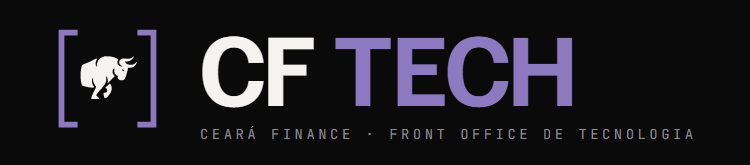

<p align="center">
  
</p>

<h2 align="center">FATOS RELEVANTES DIRETO DA CVM</h2>

<p align="center">
  <a href="https://www.instagram.com/cearafinance/"></a>
  <a href="https://www.linkedin.com/company/ceara-finance/posts/?feedView=all"></a>
  
  
  
</p>

> **Portal regulatório em tempo real da Ceará Finance com pareceres executivos sintetizados por IA (Google Gemini 3.1 Flash Lite) e sistema de alertas via WhatsApp por ticker.**

---

## 📸 Funcionalidades da Aplicação

O portal entrega dados públicos e densos da Comissão de Valores Mobiliários (CVM) de forma limpa, direta, sem filtro e em escala original:

* **Consulta por Ticker ou Código CVM:** 680+ empresas listadas da B3 monitoradas.
* **Parecer Executivo de RI (Gemini 3.1):** Síntese do comunicado com classificação objetiva (*Positivo*, *Neutro* ou *Atenção/Risco*).
* **Filtro Mensal 2026:** Navegação rápida entre Janeiro e Setembro de 2026 (mais de 33.500 comunicados catalogados).
* **Alertas no WhatsApp:** Cadastro de número para receber alertas em tempo real da ação de sua escolha (ex: `MDIA3`, `PETR4`, `VALE3` ou `TODAS`).
* **Design CF Tech v2:** Tipografia técnica, tokens monocromáticos de alta legibilidade e rolagem suave em container de 1 coluna ampla.

---

## 🛠️ Tecnologias Utilizadas

* **Linguagem:** Python 3.10+
* **Inteligência Artificial:** Google GenAI SDK (`gemini-3.1-flash-lite`)
* **Banco de Dados:** SQLite integrado (alta performance e zero fricção)
* **Frontend:** Vanilla HTML5 / CSS3 responsivo com tokens oficiais CF Tech
* **Notificações:** WhatsApp Web Click-to-Chat (`wa.me`), Z-API, Evolution API e Telegram Bot

---

## 🚀 Como Executar Localmente

### 1. Clonar o repositório
```bash
git clone https://github.com/jackrj090603-prog/fatos-relevantes-cvm.git
cd fatos-relevantes-cvm
```

### 2. Instalar as dependências
```bash
pip install -r requirements.txt
```

### 3. Configurar as variáveis de ambiente
Copie o modelo de ambiente:
```bash
cp .env.example .env
```
Edite o arquivo `.env` e insira sua chave gratuita do **Gemini** (obtida em [Google AI Studio](https://aistudio.google.com/app/apikey)):
```env
PORT=8001
GEMINI_API_KEY=sua_chave_aqui
```

### 4. Iniciar o Portal Web
```bash
python app.py
```
Acesse no seu navegador: **`http://localhost:8001`**

---

## 🤖 Como Executar o Monitor Autônomo em Segundo Plano

Para manter o robô verificando a CVM periodicamente e disparando alertas para o WhatsApp e Telegram:
```bash
python monitor.py
```

---

## ☁️ Publicação na Nuvem (Deploy)

O projeto já inclui `Procfile` e suporte à variável de ambiente dinâmica `PORT`.

### No Render ou Railway:
1. Conecte este repositório no [Render.com](https://render.com) ou [Railway.app](https://railway.app).
2. Defina o comando de inicialização: `python app.py`.
3. Adicione a variável `GEMINI_API_KEY` nas configurações de ambiente.
4. Seu portal estará no ar em minutos com HTTPS gratuito!

---

## 📱 Redes e Contato

* **Instagram:** [@cearafinance](https://www.instagram.com/cearafinance/)
* **LinkedIn:** [Ceará Finance](https://www.linkedin.com/company/ceara-finance/posts/?feedView=all)
* **Website:** Ceará Finance · Front Office de Tecnologia

---

*CF Tech · Edição 2026 · Projeto de Tecnologia e Acesso à Informação Financeira.*
